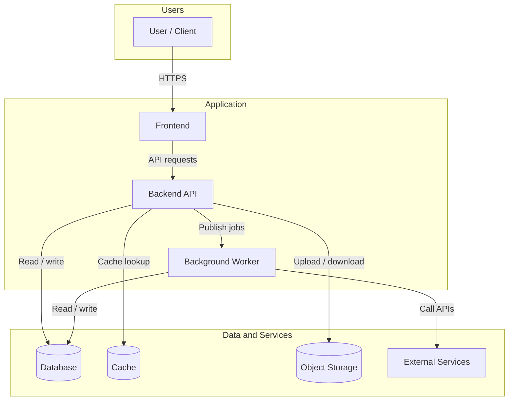

# Architecture Overview

## Components

- **Frontend:** Provides the user interface and communicates with the backend API.
- **Backend API:** Handles requests, business logic, authentication, and integrations.
- **Background Worker:** Processes asynchronous jobs and scheduled tasks.
- **Database:** Stores persistent application data.
- **Cache:** Improves performance by storing frequently accessed data.
- **Object Storage:** Stores files and other unstructured data.
- **External Services:** Provides third-party integrations and APIs.
